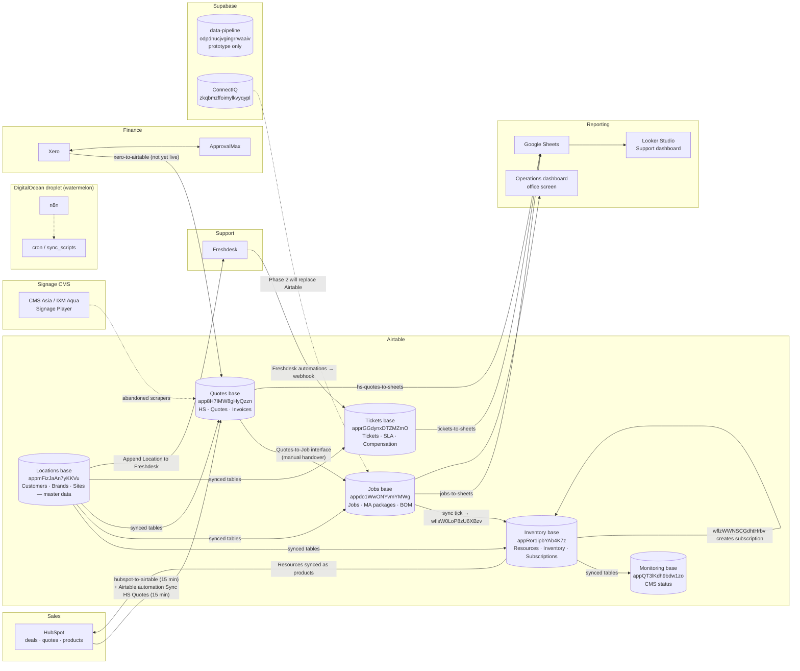

# System map

How data moves between the systems I own or touch. Boxes are systems; arrows are the pipelines in [03-data-pipelines](03-data-pipelines/) or Airtable automations in [02-airtable](02-airtable/).

## Reading the map

- **Source of truth per domain:** products and inventory → Inventory base; quotes → HubSpot (mirrored to Quotes base); jobs and maintenance → Jobs base; tickets → Freshdesk (mirrored to Tickets base); invoices → Xero. ConnectIQ (`SB2`) is becoming the source of truth for CRM in Phase 1 and will take jobs/inventory in Phase 2.
- **Human gates** are the manual steps that nothing automates: creating jobs from the Quotes-to-Job page, typing serial numbers on the job, ticking `sync`. See [07-business-logic/subscription-lifecycle.md](07-business-logic/subscription-lifecycle.md).
- **Dashed arrows** are planned or not yet in production.

ConnectIQ Supabase ref: `zkqbmzffoimylkvyqypl`. Full table-level sync map: [02-airtable/sync-topology.md](02-airtable/sync-topology.md).
